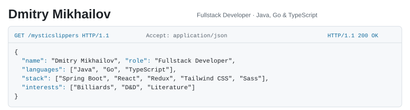

<picture>
  <source media="(prefers-color-scheme: dark)" srcset="./assets/profile-dark-v4.svg" />
  
</picture>

<a href="https://github.com/mysticslippers/library-service">
<picture>
  <source media="(prefers-color-scheme: dark)" srcset="./assets/library-dark-v4.svg" />
  
</picture>
</a>

<picture>
  <source media="(prefers-color-scheme: dark)" srcset="./assets/education-dark-v4.svg" />
  
</picture>

[@mysticslippers](https://t.me/mysticslippers) · [mikhailov.fw@yandex.ru](mailto:mikhailov.fw@yandex.ru)
