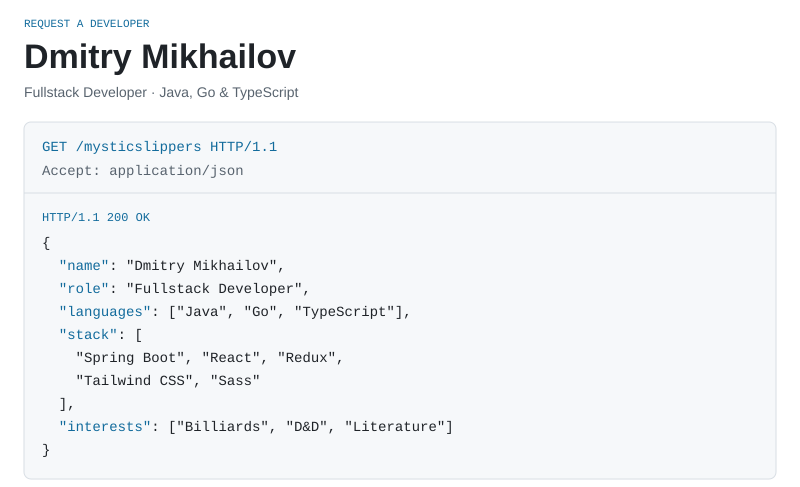
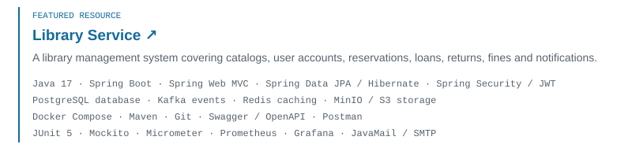
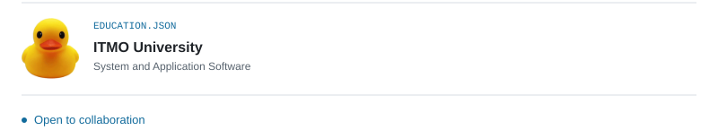

<picture>
  <source media="(max-width: 600px) and (prefers-color-scheme: dark)" srcset="./assets/profile-mobile-dark.svg" />
  <source media="(max-width: 600px)" srcset="./assets/profile-mobile-light.svg" />
  <source media="(prefers-color-scheme: dark)" srcset="./assets/profile-desktop-dark.svg" />
  
</picture>

<a href="https://github.com/mysticslippers/library-service">
<picture>
  <source media="(max-width: 600px) and (prefers-color-scheme: dark)" srcset="./assets/library-mobile-dark.svg" />
  <source media="(max-width: 600px)" srcset="./assets/library-mobile-light.svg" />
  <source media="(prefers-color-scheme: dark)" srcset="./assets/library-desktop-dark.svg" />
  
</picture>
</a>

<picture>
  <source media="(max-width: 600px) and (prefers-color-scheme: dark)" srcset="./assets/education-mobile-dark.svg" />
  <source media="(max-width: 600px)" srcset="./assets/education-mobile-light.svg" />
  <source media="(prefers-color-scheme: dark)" srcset="./assets/education-desktop-dark.svg" />
  
</picture>

[@mysticslippers](https://t.me/mysticslippers) · [mikhailov.fw@yandex.ru](mailto:mikhailov.fw@yandex.ru)

<details>
<summary>Profile data (JSON)</summary>

```json
{
  "name": "Dmitry Mikhailov",
  "role": "Fullstack Developer",
  "languages": [
    "Java",
    "Go",
    "TypeScript"
  ],
  "stack": [
    "Spring Boot",
    "React",
    "Redux",
    "Tailwind CSS",
    "Sass"
  ],
  "interests": [
    "Billiards",
    "D&D",
    "Literature"
  ]
}
```

</details>
