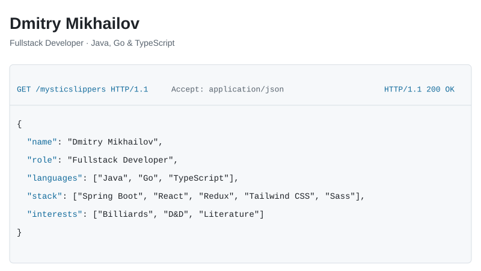
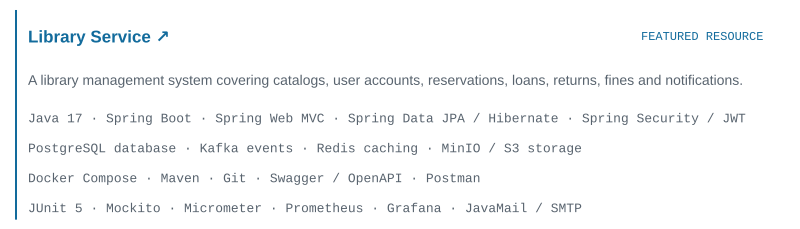
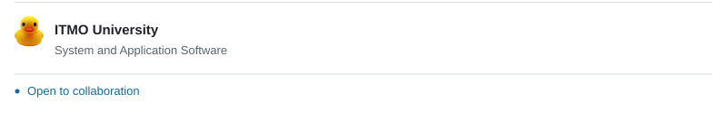

<picture>
  <source media="(prefers-color-scheme: dark)" srcset="./assets/profile-dark-v8.svg" />
  
</picture>

<a href="https://github.com/mysticslippers/library-service">
<picture>
  <source media="(prefers-color-scheme: dark)" srcset="./assets/library-dark-v8.svg" />
  
</picture>
</a>

<!-- GitHub activity: cards follow the viewer's color scheme. -->

  <a href="https://github.com/mysticslippers?tab=repositories">
    <picture>
      <source media="(prefers-color-scheme: dark)" srcset="https://github-stats-extended.vercel.app/api/top-langs/?username=mysticslippers&amp;layout=compact&amp;langs_count=8&amp;card_width=495&amp;hide_border=true&amp;disable_animations=true&amp;bg_color=0d1117&amp;title_color=80cfff&amp;text_color=e6edf3" />
      
    </picture>
  </a>
  <a href="https://github.com/mysticslippers#year-list-container">
    <picture>
      <source media="(prefers-color-scheme: dark)" srcset="https://streak-stats.demolab.com/?user=mysticslippers&amp;hide_border=true&amp;disable_animations=true&amp;background=0D1117&amp;ring=80CFFF&amp;fire=80CFFF&amp;currStreakLabel=80CFFF&amp;currStreakNum=E6EDF3&amp;sideNums=E6EDF3&amp;sideLabels=A2ADBA&amp;dates=A2ADBA&amp;stroke=303943" />
      
    </picture>
  </a>

<picture>
  <source media="(prefers-color-scheme: dark)" srcset="./assets/education-dark-v8.svg" />
  
</picture>

[@mysticslippers](https://t.me/mysticslippers) · [mikhailov.fw@yandex.ru](mailto:mikhailov.fw@yandex.ru)
