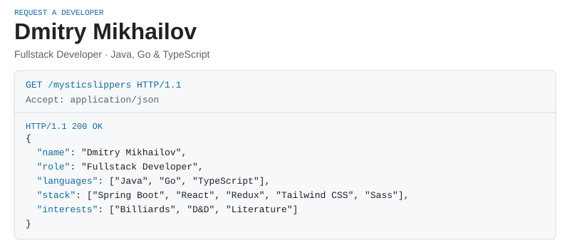
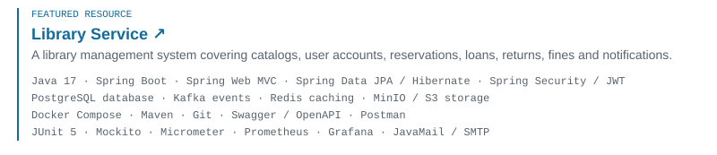
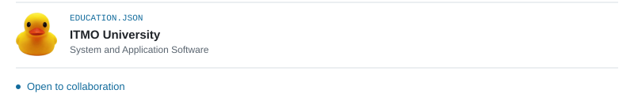

<picture>
  <source media="(max-width: 600px) and (prefers-color-scheme: dark)" srcset="./assets/profile-mobile-dark-v2.svg" />
  <source media="(max-width: 600px)" srcset="./assets/profile-mobile-light-v2.svg" />
  <source media="(prefers-color-scheme: dark)" srcset="./assets/profile-desktop-dark-v2.svg" />
  
</picture>

<a href="https://github.com/mysticslippers/library-service">
<picture>
  <source media="(max-width: 600px) and (prefers-color-scheme: dark)" srcset="./assets/library-mobile-dark-v2.svg" />
  <source media="(max-width: 600px)" srcset="./assets/library-mobile-light-v2.svg" />
  <source media="(prefers-color-scheme: dark)" srcset="./assets/library-desktop-dark-v2.svg" />
  
</picture>
</a>

<picture>
  <source media="(max-width: 600px) and (prefers-color-scheme: dark)" srcset="./assets/education-mobile-dark-v2.svg" />
  <source media="(max-width: 600px)" srcset="./assets/education-mobile-light-v2.svg" />
  <source media="(prefers-color-scheme: dark)" srcset="./assets/education-desktop-dark-v2.svg" />
  
</picture>

[@mysticslippers](https://t.me/mysticslippers) · [mikhailov.fw@yandex.ru](mailto:mikhailov.fw@yandex.ru)

